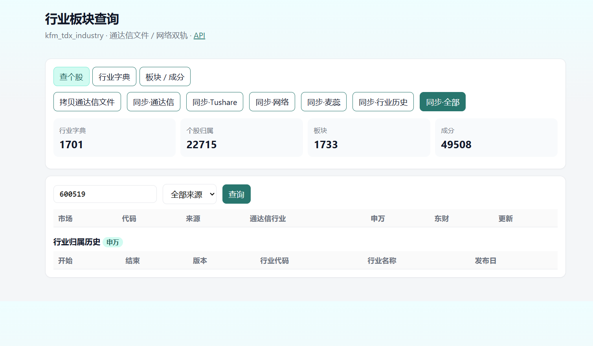

# kfm_tdx_industry

A 股 **行业 · 概念 · 风格 · 地区** 板块信息独立服务。

**多源同步**（通达信文件 / Tushare / 新浪+腾讯网络 / 麦蕊 / 申万历史）→ **SQLite** → **FastAPI**。默认端口 **13520**。

更细的通达信文件字段说明见 [`行业板块获取方案.md`](./行业板块获取方案.md)。本服务与行情主仓 `kfm_tdx_in_db_v15` 解耦，不依赖其 PostgreSQL。

> **两个库文件**：`data/industry.db` 是运行库（本地读写、不同步进 Git）；`data/industry.seed.db` 是仓库快照（开箱用）。不是两套并行业务库，详见 [§5.2.1](#521-两个-sqlite-文件)。


---

## 1. 项目原理

### 1.1 要解决什么问题

官网日线包 / 财务包 / 股票数据包（`hsjday`、`tdxfin`、`tdxgp`）**不含**「股票 ↔ 行业 / 概念」映射。  
上市板块（主板 / 创业板 / 科创板）也不是行业分类。

本项目专门补齐：

- 每股所属 **通达信新行业 / 申万行业**（及网络侧东财行业等）
- **行业 / 概念 / 风格 / 地区** 等板块字典与成分股
- 可查询、可同步、可被其他系统 HTTP 调用

### 1.2 双轨制（核心）

| 轨道 | 数据从哪来 | 运行时要不要装通达信 | 分类体系 | `source` |
|------|------------|----------------------|----------|----------|
| **A. 通达信文件** | 项目内归档的 `data/tdx_files/`（从 Windows 通达信拷贝） | **不要**（只读已拷贝文件） | 与通达信软件一致 | `tdx_file` |
| **B. Tushare** | 第三方 Tushare 接口（`stock_basic.industry`、申万分类等） | 不要 | 东财行业名 / 申万等 | `tushare` |
| **C. 网络** | **新浪**板块节点/成分 + **腾讯**行情补名称（`requests` 直连，不用 AKShare） | 不要 | 新浪行业 / 申万节点 / 概念 / 地域 | `network` |
| **D. 麦蕊** | [mairui.club](https://mairui.club/getlicence#by-count) `hszg` 行业/概念树 + 成分（licence 鉴权） | 不要 | 申万 / 概念 / 地域 / 证监会 | `mairui` |

多轨结果按 `source` **分源入库**，可对照、可指定主展示源；互不覆盖对方字段语义。

Tushare 密钥写在 **`config.local.json`**（已 gitignore，勿提交），模板见 `config.local.example.json`。

### 1.3 为什么要把通达信文件「专用保存」

- 通达信客户端仅 Windows 常见；Linux / 无客户端环境无法直接读安装目录。  
- 依赖的是 **缓存文件**，不是客户端进程：拷贝 2～6 个文件到 `data/tdx_files/` 即可跨机使用。  
- 文件变更可审计、可版本管理（大文件建议不进 Git，见常见问题）。

### 1.4 不做什么

- 不下载 / 不存储日线 K 线、财务报表正文（那是主仓职责）  
- 不把行业写入「上市 board」字段语义  
- 不以爬虫绕过数据源服务条款为设计目标

---

## 2. 架构

```text
                    ┌─────────────────────┐
   Windows 通达信    │  可选：本机 hq_cache  │──拷贝──┐
   登录更新缓存 ────►│  tdx_install 路径    │       │
                    └─────────────────────┘       ▼
                                         data/tdx_files/
                                         (incon / tdxhy / tdxzs / block_*)
                                                  │
┌──────────────┐     ┌──────────────┐     ┌───────▼────────┐     ┌────────────┐
│ Tushare/网络  │────►│ sources/     │────►│  SQLite        │◄────│ FastAPI    │
│ 麦蕊/申万历史 │     │ + parsers/   │     │  industry.db   │     │ :13520     │
└──────────────┘     └──────────────┘     │  (+ seed 快照) │     │ /api/...   │
                                          └────────────────┘     └─────┬──────┘
                                                                       ▼
                                                                浏览器 / 主仓 / 脚本
```

| 层级 | 职责 |
|------|------|
| **sources** | 多源适配：通达信归档、Tushare、新浪+腾讯、麦蕊、申万历史 |
| **parsers** | 通达信文本 / 二进制格式解析（GBK） |
| **db** | SQLite 建表、迁移、种子库复制、查询 |
| **sync_jobs** | 全量同步后台任务与进度（刷新不中断） |
| **routes** | REST：同步、统计、单股、历史、质检、板块 |
| **data/** | 运行库、种子库、通达信归档、参考字典 |

技术栈：Python 3.10+ · FastAPI · Uvicorn · SQLite3 · pandas / requests / xlrd / openpyxl · Tushare（可选）。

---

## 3. 功能

| 功能 | 说明 |
|------|------|
| 通达信文件归档 | 从本机安装目录拷贝到 `data/tdx_files/`，或手工放入 |
| 通达信 / Tushare / 网络 / 麦蕊同步 | 分源入库，互不覆盖 |
| 申万行业归属历史 | 变动段 + `sw2014`/`sw2021` 版本化字典 |
| 全量同步（带进度） | 后台任务；页面进度条；刷新可继续查看，服务端不中断 |
| 历史质量 / 覆盖缺口 | 重叠、缺口、字典关联率；缺历史证券分桶（不回填） |
| 单股 / 行业 / 板块查询 | HTML UI + REST |
| 开箱种子库 | 无运行库时自动从 `industry.seed.db` 复制 |
| OpenAPI | `/docs` |

---

## 4. 业务流程

### 4.1 通达信文件轨

```text
① Windows 登录通达信，更新行情缓存
        ↓
② 拷贝文件 → data/tdx_files/
   （或 POST /api/tdx/import 从本机路径自动拷）
        ↓
③ POST /api/sync/tdx
   · incon.dat     → industry（tdx / sw / csrc 字典）
   · tdxhy.cfg     → symbol_industry（每股 tdx_code / sw_code）
   · tdxzs.cfg     → block（行业指数等映射）
   · tdxhy × tdxzs → block_member（kind=hy 成分）
   · block_*.dat   → 概念 / 风格 / 指数成分（可选）
        ↓
④ GET /api/symbol/... 、/api/blocks/... 查询
```

最少文件：**`incon.dat` + `tdxhy.cfg`（2 个）** 即可得到每股行业。  
完整概念/风格最多约 **6 个**文件（再加 `tdxzs` + 三个 `block_*.dat`）。

### 4.2 网络轨

```text
① 确认外网可用，已安装 akshare 等依赖
        ↓
② POST /api/sync/network
   · 行业字典 / 个股分类 / 概念板块与成分
   · source 标记为 network / em / sw 等
        ↓
③ 与文件轨数据并存，按 source 查询或对比
```

### 4.3 日常更新节奏

| 场景 | 建议 |
|------|------|
| 行业微调、通达信有更新 | Windows 更新缓存 → 覆盖拷贝 `tdx_files` → `/api/sync/tdx` |
| 只要申万/东财最新 | `/api/sync/network` |
| 定期全量 | `/api/sync/all` 或系统定时任务调同一接口 |
| Linux 生产机 | 只接收 `tdx_files` 同步包，不装通达信 |

---

## 5. 数据结构

### 5.1 目录中的通达信归档

```text
data/tdx_files/
├── incon.dat                 # 行业名称字典（#TDXNHY / #SWHY / #ZJHHY）
└── hq_cache/
    ├── tdxhy.cfg             # 市场|代码|通达信行业|申万行业
    ├── tdxzs.cfg             # 或 tdxzs3.cfg：板块名|指数码|类别|…|行业码
    ├── block_gn.dat          # 概念成分（二进制，可选）
    ├── block_fg.dat          # 风格成分（可选）
    └── block_zs.dat          # 指数板块成分（可选）
```

| 源文件（通达信侧） | 拷到 |
|--------------------|------|
| 安装根或 `T0002` 上级 `incon.dat` | `data/tdx_files/incon.dat` |
| `T0002\hq_cache\tdxhy.cfg` | `data/tdx_files/hq_cache/tdxhy.cfg` |
| `tdxzs.cfg` / `tdxzs3.cfg` | 同名放入 `hq_cache/` |
| `block_gn/fg/zs.dat` | 同名放入 `hq_cache/` |

### 5.2 SQLite 表（运行库 `data/industry.db`）

#### 5.2.1 两个 SQLite 文件

| 文件 | 角色 | 是否进 Git | 说明 |
|------|------|------------|------|
| `data/industry.db` | **运行库** | 否 | 服务实际读写；同步、查询都打这里 |
| `data/industry.seed.db` | **种子快照** | 是 | 克隆后若无运行库，启动时自动复制为 `industry.db` |

日常开发/生产只需关心运行库；更新仓库快照时，把当前运行库拷成 seed 再提交即可。

#### 5.2.2 主要表

```text
industry / industry_dict     -- 行业字典；dict 带 version（sw2014 / sw2021）互不覆盖
symbol_industry              -- 每股当前归属（按 source 分源）
symbol_industry_hist         -- 申万归属历史段（taxonomy_version、生效日、发布日、同步日）
block / block_member         -- 板块与成分
sync_log                     -- 同步日志
```

日期语义（历史表，防回测未来函数）：

| 字段 | 含义 |
|------|------|
| `start_date` / `end_date` | 归属**生效**区间（空 end = 至今） |
| `update_time`（API 别名 `published_at`） | 数据源**发布/修订**可知日 |
| `synced_at` | 本系统入库时间（不可作 as-of） |

主键带 `source`（及字典的 `version`），保证多源/多版并存。

### 5.3 代码与配置布局

```text
kfm_tdx_industry/
├── README.md
├── requirements.txt
├── run.py / run.bat
├── config.json / config.local.json   # local 含密钥，勿提交
├── app/
│   ├── main.py / db.py / sync_jobs.py
│   ├── parsers/  sources/  routes/  qa/
│   └── static/index.html             # 查询 UI（含同步进度条）
└── data/
    ├── industry.seed.db              # Git 快照
    ├── industry.db                   # 运行库（gitignore）
    ├── ref/sw2014.csv                # 申万 2014 参考字典
    └── tdx_files/
```

### 5.4 配置项（`config.json`）

```json
{
  "host": "0.0.0.0",
  "port": 13520,
  "db_path": "data/industry.db",
  "tdx_files_dir": "data/tdx_files",
  "tdx_install_hq_cache": ""
}
```

---

## 6. 安装 / 部署 / 运行

### 6.1 环境要求

- Python **3.10+**
- 磁盘：SQLite + 数 MB～十余 MB 通达信小文件即可  
- 网络轨需要能访问对应数据源；文件轨可完全离线（归档齐备时）

### 6.2 安装

```bash
cd kfm_tdx_industry
python -m venv .venv

# Windows
.venv\Scripts\activate
# Linux / macOS
# source .venv/bin/activate

pip install -r requirements.txt
```

### 6.3 准备通达信归档（文件轨）

1. Windows 打开通达信并更新行情。  
2. 按 **§5.1** 拷贝到 `data/tdx_files/`。  
3. 或配置 `tdx_install_hq_cache` 后调用导入接口自动拷贝。

### 6.4 运行

```bash
python run.py
# 等价：
# uvicorn app.main:app --host 0.0.0.0 --port 13520
```

| 地址 | 用途 |
|------|------|
| http://127.0.0.1:13520/ | 服务入口 |
| http://127.0.0.1:13520/docs | Swagger |
| http://127.0.0.1:13520/redoc | ReDoc |

### 6.5 API 一览

| 方法 | 路径 | 说明 |
|------|------|------|
| `GET` | `/api/health` | 健康检查 |
| `GET` | `/api/stats` | 统计 |
| `POST` | `/api/tdx/import` | 本机路径 → 拷贝到 `tdx_files` |
| `POST` | `/api/sync/tdx` | 通达信同步 |
| `POST` | `/api/sync/tushare` | Tushare 同步 |
| `POST` | `/api/sync/network` | 网络同步（新浪+腾讯） |
| `POST` | `/api/sync/mairui` | 麦蕊同步 |
| `POST` | `/api/sync/industry-history` | 申万历史 + 双版字典 |
| `POST` | `/api/sync/all` | 后台全量同步（立即返回 `job_id`，刷新不中断） |
| `GET` | `/api/sync/jobs/active` | 当前/最近同步任务 |
| `GET` | `/api/sync/jobs/{id}` | 同步任务进度 |
| `GET` | `/api/symbol/{symbol}` | 单股当前归属 |
| `GET` | `/api/symbol/{symbol}/industry-history` | 行业归属历史 |
| `GET` | `/api/industry-dict` | 版本化申万字典 |
| `GET` | `/api/industry-history/quality` | 历史质量检查 |
| `GET` | `/api/industry-history/coverage` | 缺历史证券分桶 |
| `GET` | `/api/industries` | 行业字典列表 |
| `GET` | `/api/blocks` | 板块列表 |
| `GET` | `/api/blocks/{kind}/{code}/members` | 成分 |

以实际 `/docs` 为准。页面「同步·全部」带进度条，刷新后会自动恢复未完成任务的进度展示。

### 6.6 与主仓协作

| 项目 | 端口 | 存储 | 职责 |
|------|------|------|------|
| `kfm_tdx_in_db_v15` | 18888 | PostgreSQL | 日线 / 财务 / 评分等 |
| **本项目** | **13520** | **SQLite** | 行业板块多源 + 历史 |

主仓可通过 HTTP 拉取本服务补全行业列，或定期导出再导入主库。

### 6.7 部署建议

- 单机：`run.py` / Windows 服务 / systemd 守护均可。  
- Linux：只部署本仓库 + `data/tdx_files`；用 `rsync`/共享盘更新归档文件。  
- 备份：拷贝整个 `data/` 目录即可恢复库与通达信归档。  
- 勿把含完整行情的无关大目录塞进本项目。

---

## 7. 常见问题

**Q: 必须本机安装通达信吗？**  
A: 运行时不必须。需要的是 `data/tdx_files` 里的缓存文件。可在任意 Windows 机更新后拷贝过来。

**Q: Linux 怎么办？**  
A: 用文件同步（共享盘 / rsync / 网盘）维护 `tdx_files`；或仅用网络轨。

**Q: 通达信要拷几个文件？**  
A: 最少 **2**（`incon.dat` + `tdxhy.cfg`）；加板块映射与概念大约 **3～6** 个。不要整盘拷贝通达信安装目录。

**Q: 两轨行业名称不一致？**  
A: 正常。体系不同。查询时带 `source`，或业务层指定优先 `tdx_file`。

**Q: `tdxzs.cfg` 和 `tdxzs3.cfg`？**  
A: 不同版本文件名可能不同，有哪个拷哪个；解析器应兼容。

**Q: 网络同步失败？**  
A: 检查外网与新浪/腾讯可达性；不依赖 AKShare。文件轨可离线独立使用。

**Q: 编码乱码？**  
A: 通达信文本多为 **GBK/GB2312**，须按该编码读取。

**Q: 为什么有两个 `.db`？都要吗？**  
A: 要，但职责不同。`industry.db` = 运行库（本地、gitignore）；`industry.seed.db` = Git 快照，仅用于开箱复制。不是两套同时读写的业务库。

**Q: 大文件要不要进 Git？**  
A: 运行库与 `data/tdx_files/**`、`data/cache/` 不入库；seed 与 `data/ref/sw2014.csv` 可入库。

**Q: 和「上市板块」有什么区别？**  
A: 主板/创业板/科创板是交易板块；本项目做的是行业与概念分类，语义不同，勿混用字段。

**Q: 端口被占用？**  
A: 修改 `config.json` 的 `port`，或启动参数指定其他端口。

---

## 8. 版权与声明

1. **本仓库软件代码**  
   著作权归项目作者所有。未附加 LICENSE 时默认保留所有权利；仅授权个人学习与非商业研究用途。若根目录后续补充 LICENSE，以该文件为准。

2. **通达信及相关数据**  
   通达信软件、行业分类、板块成分等数据之版权与知识产权归通达信及相应权利人所有。本项目仅对用户合法取得的本地缓存做解析与归档，不提供通达信安装包，不破解、不绕过官方授权。

3. **网络数据源**  
   经 AKShare 等获取的申万、东财等数据，须遵守各数据源网站的服务条款、robots 约定及当地法律法规；请合理控制频率，勿用于商业转售或违规爬取。

4. **免责**  
   本项目仅用于学习与数据归档研究，**不构成任何投资建议**。使用本软件及其中数据所产生的任何后果由使用者自行承担。

5. **商标**  
   「通达信」及其他商标归其权利人所有；本项目名称 `kfm_tdx_industry` 仅为功能标识，不代表与官方存在合作或背书关系。
